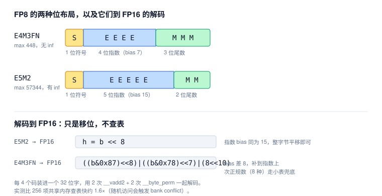
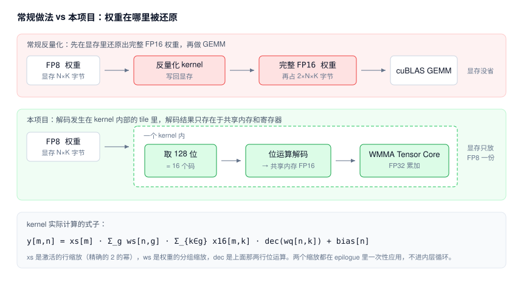
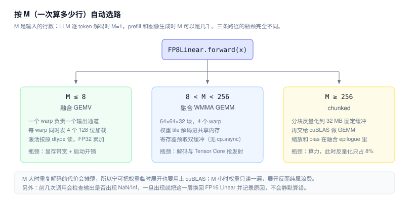

# FP8 Compatibility Layer

在**没有原生 FP8 硬件**的 NVIDIA Turing 显卡（RTX 2080 Ti，sm_75）上运行 FP8 模型的兼容层。

FP8 权重以 `uint8` 编码 + FP32 scale 的形式常驻显存，在 kernel 的 tile 内用查表/位运算解码成 FP16，再交给 FP16 Tensor Core 做 FP32 累加。**全程不生成完整的 FP16 权重副本。**

> 这个项目省的是**显存和带宽**，不是算力。Turing 没有 FP8 张量核，它不会让你得到“原生 FP8 速度”。具体数字见下方[实测结果](#实测结果rtx-2080-ti)。

> [!IMPORTANT]
> **本项目只针对 NVIDIA GeForce RTX 2080 Ti。** 所有 kernel 的参数、性能数据和正确性验证都只在这张卡上做过。其他型号能否运行、结果是否正确、性能如何，目前都**尚不明确**，请勿直接套用。

## 特性

- **两种 FP8 格式**：E4M3FN、E5M2。256 个编码全部与 `torch.float8_*` 逐位一致，包括 ±0、次正规数、NaN、inf。
- **编码器**：最近偶数舍入（RNE），超出范围时饱和到 ±max_finite，不会产生 inf。
- **缩放粒度**：per-tensor、per-channel、per-K-group（32 / 128），scale 可以是 FP32 或 UE8M0（2 的幂）。
- **融合反量化 kernel**：
  - GEMV（M ≤ 8，用于 decode）
  - 64×64 WMMA GEMM，带寄存器预取双缓冲
  - chunked 路径：先反量化到固定 32 MB workspace，再调用 cuBLAS，最后用一个融合 epilogue 收尾
- **`tfp8` 运行库**：可以直接替换 `nn.Linear` 的 `FP8Linear`。它按 M 自动选择计算路径，输出出现 NaN/Inf 时自动回退，还会检测 tied weight，并逐模块规划哪些层量化、哪些保持原精度。
- **不依赖 nvcc**：kernel 由 NVRTC 在运行时编译，再用 ctypes 调 `cuLaunchKernel` 启动。这样可以绕开 Windows 上 MSVC 版本比 CUDA 新导致 nvcc 崩溃的问题。
- **FP8 训练数值模拟**：在小 Transformer 上对比 5 种 FP8 训练方案和 FP32 基线。

## 环境要求

- **NVIDIA GeForce RTX 2080 Ti（Turing，sm_75）**：这是目前唯一支持的显卡。其他型号（包括其他 Turing 卡）的兼容性尚不明确
- Python 3.10+、PyTorch（CUDA 版，需要带 `torch.float8_*` dtype 和 NVRTC）
- 只编译 C++ 宿主测试程序时才需要 MSVC（`cl`）

```bash
pip install -r requirements.txt
```

## 快速开始

所有命令都在仓库根目录运行。

```bash
python -m tfp8                    # 自检 + 环境报告
python -I tests/test_tfp8.py      # 19 项数值门禁
```

### 在自己的模型上使用

```python
import torch
from tfp8 import FP8Config, prepare_model, report, weight_bytes

model = MyModel().half().cuda()

cfg = FP8Config(fmt="e4m3fn", profile="llm_safe", weight_group=None)  # None = per-channel；128 = 按 K 分组
model = prepare_model(model, domain="llm", config=cfg)                # 图像模型用 domain="image"

report(model)                 # 打印每个模块的处理决定（量化 / 保持原精度）及原因
print(weight_bytes(model))
```

也可以单独替换某一层：

```python
from tfp8 import FP8Linear

fp8_layer = FP8Linear.from_linear(linear, fmt="e4m3fn", group_size=128)
```

### 示例

```bash
python -m tfp8.examples.demo_llm --size tiny                       # Llama 结构 LLM：显存、logits 一致性、prefill/decode
python -m tfp8.examples.demo_image --size 64 --dim 512 --depth 8   # DiT 图像生成：显存、PSNR/SSIM、每步耗时
python -I demos/tiny_dlss.py --steps 800                           # 自建时域超分小网络，用 W8A8 融合 GEMM 推理
```

## 原理

### 1. FP8 是什么，以及为什么解码可以很便宜

FP8 就是用 1 个字节表示一个浮点数。8 位怎么分给指数和尾数有两种常见约定：E4M3FN 指数少、精度高、范围小，适合权重和前向激活；E5M2 指数多、范围大、精度低，适合梯度这类动态范围大的量。

关键在于：**FP16 也是指数在前、尾数在后的同构布局**，所以 FP8 转 FP16 不需要真的做浮点运算，只要把位搬到正确的位置上。E5M2 和 FP16 的指数 bias 都是 15，整体左移 8 位就得到对应的 FP16；E4M3FN 的 bias 是 7，差 8，补到指数字段上即可。



真正写进 kernel 的还要再快一层：一次取 32 位（4 个码），用 2 次 `__vadd2` 加 2 次 `__byte_perm` 把 4 个值一起算出来，而不是逐字节分支判断。项目里也保留了 256 项查找表，但它只作为未知格式的兜底——实测随机访问查找表会触发共享内存 bank conflict，反而比位运算慢约 1.6 倍。

### 2. 核心思路：解码发生在 kernel 内部

常规的量化推理库通常是两步走：先用一个反量化 kernel 把 FP8 权重还原成完整的 FP16 张量写回显存，再调用 cuBLAS 做矩阵乘。这样确实能用上 Tensor Core，但显存里同时躺着 FP8 和 FP16 两份权重，**压缩带来的显存收益当场就还回去了**。

本项目把解码塞进矩阵乘 kernel 内部：每个线程块只在自己要算的那一小块（tile）上，把 FP8 搬进共享内存时顺手解码成 FP16，算完就丢。**全程没有任何完整的 FP16 权重被写回显存。**



代价是同一块权重会被不同的线程块重复解码。这个代价是否划算取决于 M，也就是下面的选路。

### 3. 缩放：为什么不能直接存 FP8

E4M3FN 的最大值只有 448，而且只有 3 位尾数。直接把权重塞进去，要么溢出，要么小值全被舍成 0。所以必须先除以一个缩放系数，把数值挪进 FP8 能表示的区间：

```
scale = max|w| / FP8_MAX        # 默认向上取整到 2 的幂
q     = RNE(clamp(w / scale, -FP8_MAX, FP8_MAX))
```

缩放系数**向上取整到 2 的幂**是有讲究的：乘除 2 的幂只动指数、不碰尾数，是无损的，因此量化和还原不会引入额外的舍入误差。

缩放的粒度是个取舍：每个输出通道一个系数（per-channel）开销最小；每 128 个输入维度一个系数（per-K-group）更能对付局部离群值，但系数更多、kernel 里也更麻烦。训练模拟那张表最能说明缩放的必要性——**完全不做缩放时，99.66% 的梯度直接下溢为 0，训练彻底停滞**。

激活侧还有一个独立的行缩放：每一行除以一个 2 的幂，把数值挪到远离 FP16 溢出的区间，这样 BF16 激活能安全地转成 FP16 去喂 Tensor Core（Turing 的 BF16 没有 Tensor Core 支持）。

### 4. 三条计算路径

同一个 `FP8Linear` 在不同 M 下走完全不同的 kernel，因为瓶颈不一样：M=1 时整层只读一遍权重，纯粹卡在显存带宽和 kernel 启动开销上；M 很大时计算量上来了，瓶颈变成算力。



这也解释了为什么 M ≥ 256 反而要退回「先展开再 cuBLAS」：这时解码只占总时间的 8% 左右，而自己写的 tile GEMM 实在追不上 cuBLAS。

### 5. 为什么主要省显存，不当算力卖

Turing 的 Tensor Core 只认 FP16，不认 FP8。所以无论怎么优化，最终送进计算单元的都是 FP16，**计算量和直接用 FP16 完全一样，还额外多了解码的开销**。能省的只有两样东西：权重占的显存（约 −44%），以及从显存搬运权重的带宽。

带宽是能换成速度的，但只在权重确实压着带宽的时候。M=1 时底层权重层（43–48 MB）已经跑到 1.32–1.53× 于 FP16 cuBLAS，小层（≤16 MB）只能到 0.86–1.01×（单次 kernel 提交约 28 µs 的地板），M≥4 则基本打平——那时 cuBLAS 自己也能吃满带宽。所以这个项目的定位仍然是**让放不下的模型能放下**：显存是它交付的东西，速度是顺带的，且只在一段 M 区间里成立。

### 参考资料

| 对应小节 | 资料 | 说明 |
|---|---|---|
| 1. 格式 | [FP8 Formats for Deep Learning](https://arxiv.org/abs/2209.05433)（Micikevicius 等，2022） | E4M3 / E5M2 两种格式的定义，以及“前向用 E4M3、梯度用 E5M2”的依据 |
| 1. 格式 | [PyTorch 文档：`torch.float8_e4m3fn` / `float8_e5m2`](https://docs.pytorch.org/docs/stable/tensor_attributes.html) | 本项目逐位对照的参考实现 |
| 3. 缩放 | [Microscaling Data Formats for Deep Learning](https://arxiv.org/abs/2310.10537)（Rouhani 等，2023） | 按 32 个元素一组、UE8M0（2 的幂）scale 的 block 缩放，对应本项目的 block32 / K-group 模式 |
| 3. 缩放 | [FP8 versus INT8 for efficient deep learning inference](https://arxiv.org/abs/2303.17951)（van Baalen 等，2023） | FP8 与 INT8 推理精度的对比 |
| 2、4. 融合解码 | [MARLIN](https://arxiv.org/abs/2408.11743)（Frantar 等，2024） | 同类思路：低比特权重常驻显存，在 kernel 内解码后喂 Tensor Core，用于 LLM 推理 |
| 2、4. kernel 实现 | [CUDA C++ Programming Guide：Warp Matrix Functions (WMMA)](https://docs.nvidia.com/cuda/cuda-c-programming-guide/index.html#wmma) | 融合 GEMM 使用的 Tensor Core 接口 |
| 2、4. kernel 实现 | [NVRTC 文档](https://docs.nvidia.com/cuda/nvrtc/index.html) | 运行时编译 kernel、不依赖 nvcc 的方式 |
| 5. 硬件 | [NVIDIA Transformer Engine](https://github.com/NVIDIA/TransformerEngine) | 在原生支持 FP8 的硬件（Hopper 及以后）上的 FP8 实现，可作为本项目所模拟对象的对照 |

这些资料说明的是思路的来源，不代表本项目复现了其中任何一个实现。

## 项目结构

| 路径 | 内容 |
|---|---|
| `tfp8/` | W8A16 运行库：`formats`（编解码 / LUT）、`quantize`、`linear`（`FP8Linear`）、`planner`、`_ext`（NVRTC + 启动）、`csrc/tfp8_kernels.cu`、`examples/` |
| `fp8.h`、`fp8_gemm_kernel.cu` | 独立的 C++/CUDA 核心：FP8 格式、编码器、LUT 和融合反量化 GEMM（W8A8，支持 block32 与 row/col 两种缩放） |
| `fp8_cuda.py` | 把 `fp8_gemm_kernel.cu` 接入 PyTorch 的最小 ctypes 绑定 |
| `lut_e4m3fn.bin`、`lut_e5m2.bin` | 宿主测试程序导出的 256 项解码表 |
| `train/` | FP8 训练数值模拟（`fp8_sim.py`）、对比实验（`train_compare.py`）、报告（`report.html`） |
| `demos/` | `tiny_dlss.py`：时域超分 demo |
| `tests/` | 数值门禁、GPU/CPU 基准、C++ 宿主测试驱动，详见 [tests/README.md](tests/README.md) |
| `docs/` | C++ 核心、超分 demo 和训练实验的详细说明 |

## 实测结果（RTX 2080 Ti）

**单层 4096×4096 的延迟**（单位 ms，取中位数，`python -I tests/benchmark.py`）：

| M | BF16 | FP16 | 完整反量化 | tfp8 fused | tfp8 chunked |
|---:|---:|---:|---:|---:|---:|
| 1 | 0.111 | 0.140 | 1.481 | 0.184 | 0.193 |
| 8 | 0.355 | 0.111 | 1.487 | 0.186 | 0.187 |
| 128 | 0.591 | 0.106 | 1.521 | 0.329 | 0.412 |
| 2048 | 8.791 | 0.766 | 2.092 | 4.304 | 1.528 |

**端到端**（模型均为随机权重，验证的是数值和显存，不代表生成质量）：

| 模型 | 权重显存 | 精度 | 速度 |
|---|---|---|---|
| LLM 1B（16 层） | 1501 → 846 MB（**−43.6%**） | — | decode ≈1.0×，prefill ≈1.0× |
| LLM tiny（2 层，dim 1024） | 59.0 → 38.6 MB（−34.6%） | logits cosine 0.9973 | decode 0.92× |
| DiT 64px（8 层，dim 512） | 76.4 → 52.6 MB（−31.1%） | PSNR 51.0 dB / SSIM 0.9951 | 慢 1.8× |

**FP8 训练模拟**（4 层 Transformer，3000 步）：只要做了缩放，FP8 方案和 FP32 的差距都在噪声范围内。不做缩放时，99.66% 的梯度下溢为 0，训练完全停滞。

| 方案 | val loss | 序列准确率 |
|---|---|---|
| FP32 基线 | 0.0004 | 99.80% |
| FP8 per-tensor E4M3 / E5M2 | 0.0005 | 99.85% |
| FP8 block32 UE8M0 E4M3 / E5M2 | 0.0009 | 99.76% |
| FP8 无缩放 E4M3 / E5M2 | 1.4922 | 0.00% |

更多数据和分析：

- [tfp8/README.md](tfp8/README.md)：各计算路径的延迟、decode 专项 A/B 测试、已修复的 bug
- [tfp8/BENCH_TRANSCODE.md](tfp8/BENCH_TRANSCODE.md)：FP8 转译吞吐实测
- [benchlab/README.md](benchlab/README.md)：基准测试页面（本机运行 + 任意显卡并排对比）
- [docs/fp8_gemm_and_demos.md](docs/fp8_gemm_and_demos.md)：C++ 核心、超分 demo、训练实验

## 已知限制

- `tfp8` 目前只支持 **W8A16**。W8A8 激活、FP8 KV Cache 会显式报 `NotImplementedError`，不会静默降级。
- 融合 GEMM 是教学级 tile 实现（约 19–21 TFLOPS），远低于 cuBLAS FP16（约 76 TFLOPS）。M 大时默认走 chunked 路径。
- 在 Windows/WDDM 上，经 ctypes 启动一次 kernel 就要约 28 µs，小层（≤16 MB）的 decode 只能达到 FP16 cuBLAS 的 0.86–1.01×。
- `FP8Linear.from_fp8_checkpoint` 只校验 dtype 和 scale 形状，还没有对接任何社区 checkpoint 的真实 metadata 布局。
- **只在单张共享使用的 RTX 2080 Ti 上测过，其他型号尚不明确。** 即使在 2080 Ti 上，绝对耗时会受外部负载和时钟状态影响，比值更有参考价值。

## 许可证

[MIT](LICENSE)
